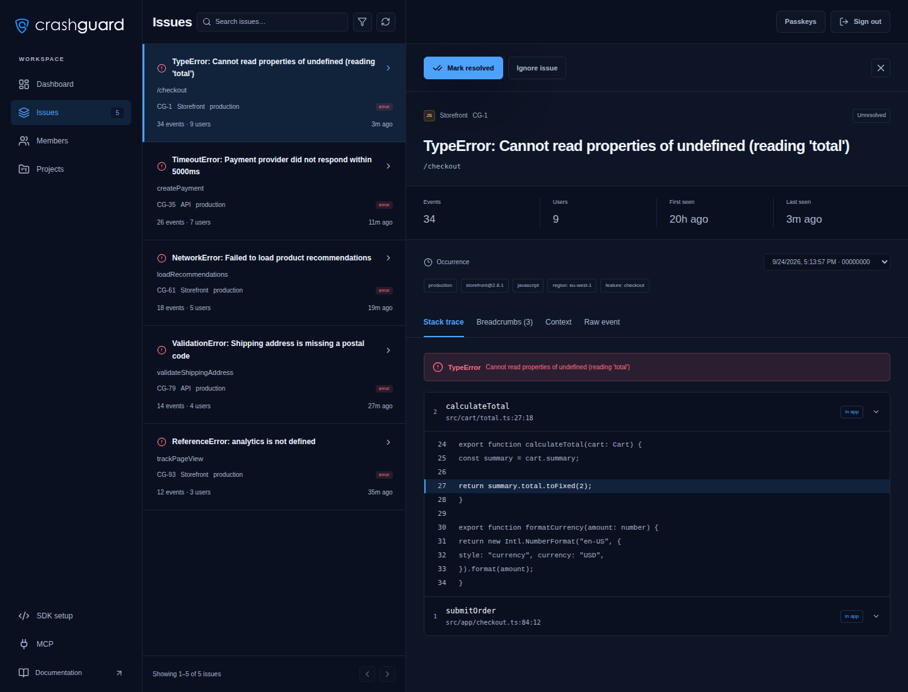

# CrashGuard

Self-hosted error tracking using Sentry SDKs, with SQLite storage and built-in MCP for coding assistants. MIT licensed.

**Next.js 16 · React 19 · TypeScript · Tailwind CSS 4 · SQLite**



Explore the [dashboard](screenshots/dashboard.png) for event activity and summary metrics, the [issue list](screenshots/issues.png) for filtering and managing errors, and [issue details](screenshots/issue-details.png) for stack traces and source context. All screenshots use illustrative data from a local demo workspace.

**Compatibility:** CrashGuard accepts supported Sentry **envelopes**. Sentry management APIs, `sentry-cli` release/source-map uploads, and legacy `/store/` ingestion are outside its scope. See the [compatibility details](docs/operations.md#sdk-compatibility) before migrating.

## Quick start

Requires **Git, Node.js 22.13+** (24 recommended), npm, and a browser with passkey support. These commands use Bash on Linux, macOS, or WSL. For a container install, use [Docker](#docker).

```bash
git clone https://github.com/suciudan/crashguard.git
cd crashguard
npm ci
cp -n .env.example .env.local
npm run dev -- --hostname 127.0.0.1
```

1. Open [localhost:5000](http://localhost:5000) on this machine and create your first passkey (the workspace owner).
2. Open **Projects → New project**, name it, and create it. **SDK setup** displays its DSN.
3. In a second terminal in the checkout, send an actual Node SDK exception using the copied DSN:

   ```bash
   npm run example:error -- 'http://PROJECT_PUBLIC_KEY@localhost:5000/PROJECT_ID'
   ```

4. Open **Issues** and select **Hello from CrashGuard**. Inspect its stack trace, `first-run` environment, and `example=node` tag. The example prints the event ID so you can identify the occurrence.

**SDK setup** also has a test-event button for checking ingestion without a Node application. Next, [connect your own app](#connect-your-app) or [connect an assistant through MCP](docs/mcp.md).

If SQLite's native module fails to build on Ubuntu, install `build-essential` and `python3`, then rerun `npm ci`.

## Docker

Requires Git and Docker with Compose v2.20+ on Linux/WSL or Docker Desktop. This builds the current checkout. Stop the local server first if it uses the same port and database.

```bash
git clone https://github.com/suciudan/crashguard.git
cd crashguard
cp -n .env.example .env.local
mkdir -p data
# Linux/WSL: run as your regular user and match the data directory's owner.
export CRASHGUARD_UID=$(id -u) CRASHGUARD_GID=$(id -g)
docker compose --env-file .env.local up -d --build --wait
```

Open [localhost:5000](http://localhost:5000), enroll a passkey, create a project, and use **SDK setup → Send a test from this browser**. Open the resulting issue in **Issues**. SQLite stays on the host:

```text
./data/crashguard.sqlite → /app/data/crashguard.sqlite
```

Set `CRASHGUARD_DATA_DIR` in `.env.local` to use another host directory; create it before starting. The container user must be able to write there. Container replacement preserves your data.

```bash
docker compose --env-file .env.local logs -f
docker compose --env-file .env.local down
```

See [deployment and storage](docs/operations.md#deployment-and-storage) for permissions, backups, and native crash processing.

Before using a remote server, configure a stable HTTPS hostname and `APP_URL`; passkeys only allow plain HTTP on localhost. Bind to loopback behind your reverse proxy and restrict access until the first owner is enrolled. `localhost` in an application's DSN refers to **that application's machine**.

Back up the full data directory while the service is stopped, or use SQLite's online backup API. **There is no automatic retention**: monitor disk growth, especially with replay, profiles, and attachments.

For GitHub Actions deployment to a VPS with a self-hosted runner, follow the [production setup](docs/deployment.md). It includes image builds, deployment approval, and SQLite backups.

## Connect your app

Install the appropriate [Sentry SDK](https://docs.sentry.io/platforms/) in your application and use the DSN from **SDK setup**.

```bash
npm install @sentry/browser  # use @sentry/node for a Node backend
```

```ts
import * as Sentry from "@sentry/browser";

Sentry.init({
  dsn: "http://PROJECT_PUBLIC_KEY@localhost:5000/PROJECT_ID",
  environment: "production",
  release: "my-app@1.0.0",
  sendDefaultPii: false,
  enableLogs: true,
});

Sentry.captureException(new Error("Hello from my app"));
Sentry.logger.info("Application started");
```

Initialize the SDK before your application code. Framework SDKs use their normal setup with the CrashGuard DSN. For remote apps, replace `localhost` with your reachable CrashGuard host.

## Features

Connect **Codex or Claude Code** through **MCP** to search issues, inspect error events, and mark issues as resolved with an MCP token. See [MCP setup](docs/mcp.md).

| Area                         | Support                                                                                                                               |
| ---------------------------- | ------------------------------------------------------------------------------------------------------------------------------------- |
| Issues                       | Complete paginated history, custom date ranges, grouping, search, resolve/reopen/ignore, stack traces, breadcrumbs, and event context |
| Performance & logs           | Transactions, span timelines, structured logs, and trace correlation                                                                  |
| Replay & profiles            | DOM replay with playback controls; transaction and continuous sampled profiles                                                        |
| Attachments & native crashes | Binary downloads; minidump processing through optional Symbolicator                                                                   |
| Releases & source maps       | Release tracking and source-map uploads through the UI                                                                                |
| Alerts                       | Signed webhooks plus browser/Android push for new and reopened errors, with persistent delivery queues                                |
| Android app                  | Installable PWA, home screen icon, standalone window, and an offline fallback                                                         |

SDK ingestion uses `POST /api/:projectId/envelope/`. Sentry management and `sentry-cli` release/upload APIs are not implemented.

The issue list defaults to **All time**. Use **Issue filters → Custom dates** to
browse an earlier UTC date range, or choose **All issues** to include resolved and
ignored issues. The footer shows the complete matching total; 30 issues are loaded
per page. Within an issue, **Older occurrences** and **Newer occurrences** browse
its complete event history in pages of 50.

See [SDK compatibility](docs/operations.md#sdk-compatibility) for supported formats, limits, and feature setup.

Open **Notifications** to enable Firefox or phone alerts and install the Android
app. Each device opts in separately; use a reachable HTTPS address on your phone.
See [notifications and Android setup](docs/notifications.md).

## Configuration

Copy [.env.example](.env.example) to `.env.local`.

| Variable              | Default / purpose                                                    |
| --------------------- | -------------------------------------------------------------------- |
| `DATABASE_PATH`       | `./data/crashguard.sqlite` for local runs                            |
| `APP_URL`             | Server-only runtime origin; the example uses `http://localhost:5000` |
| `AUTH_ORIGIN`         | Defaults to the public URL; used for passkeys and dashboard requests |
| `INGEST_RATE_LIMIT`   | `120` requests per project per minute                                |
| `CRASHGUARD_DATA_DIR` | `./data` — host storage directory for Docker                         |

For production, set `APP_URL` to a stable HTTPS origin in the server's runtime environment:

```bash
npm run build
npm start
```

Both local servers use port **5000**. Production configuration is supplied at runtime and is not embedded in the image or browser bundle. The deployment workflow reads secrets from GitHub's `production` Environment. Use persistent local storage; there is no automatic data retention.

The first passkey creates the workspace owner account. Enroll it before exposing a fresh installation, and add backup keys under **Passkeys**. Existing installations retain their passkeys under the owner account.

To invite a colleague, open **Members → select a project → Create invitation link**. Share the link privately; they choose an account name and create a passkey. Each link grants access to one project, expires after seven days, and works once. Owners can revoke links or remove project access from the same panel. [Access and recovery details →](docs/operations.md#passkeys-and-recovery)

## Development

```bash
npm test                # isolated protocol, storage, auth, and telemetry tests
npm run typecheck
npm run build
```

GitHub Actions runs tests, type checks, a production build, and a real Node SDK smoke test against an isolated instance. Browser, passkey, replay, native-crash, and Docker checks are available separately. See [testing](docs/testing.md) for commands. Coverage percentages are not configured yet.

| Path                       | Purpose                                                          |
| -------------------------- | ---------------------------------------------------------------- |
| `src/app/actions/`         | Authenticated UI operations                                      |
| `src/app/api/[projectId]/` | Sentry ingestion                                                 |
| `src/lib/`                 | SQLite, validation, grouping, symbolication, and background jobs |
| `src/components/`          | Dashboard and feature views                                      |
| `tests/`, `scripts/`       | Unit and integration tests                                       |

## License

[MIT](LICENSE)
